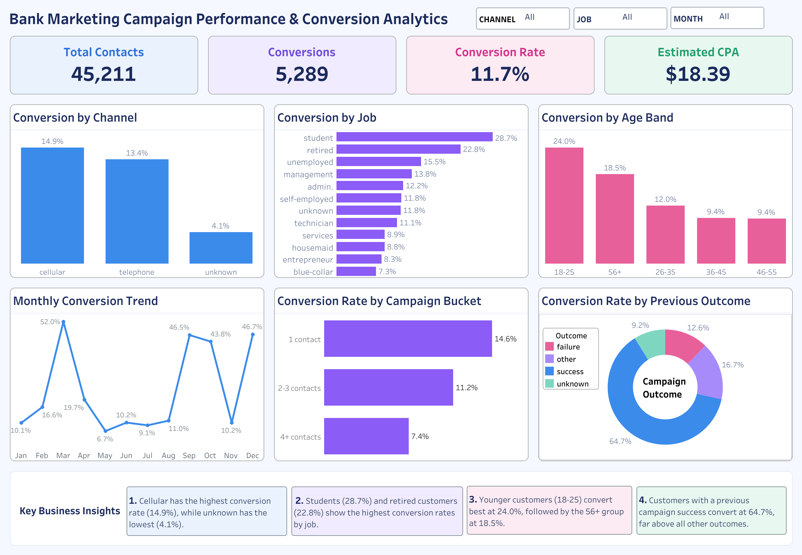
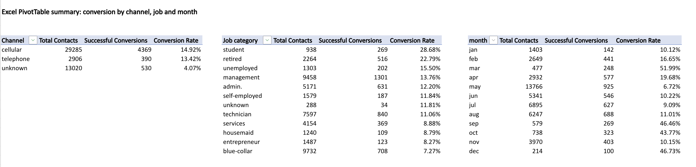

<div align="center">

# 📊 Bank Marketing Campaign Performance & Conversion Analytics

### End-to-End Data Analytics Project using Excel, Python, SQL & Tableau


</div>


# 📊 Dashboard Preview

<p align="center">
  
</p>

---

# 📌 Project Overview

This project analyzes a Portuguese bank's direct marketing campaign data using **Excel, Python, MySQL, and Tableau** to understand which contact channels, customer groups, campaign months, and contact-history patterns are associated with successful term-deposit subscriptions.

The project follows an end-to-end analytics workflow, from data preparation and validation to SQL business analysis and interactive dashboard development, transforming historical campaign data into meaningful KPIs and business insights.

---

# 🎯 Business Objectives

- Measure overall campaign performance using key performance indicators (KPIs).
- Identify contact channels and job categories with higher observed conversion rates.
- Analyze conversion patterns across customer age groups and campaign months.
- Understand how previous campaign outcomes relate to current conversions.
- Evaluate the relationship between contact frequency and conversion.
- Build an interactive Tableau dashboard to communicate business findings.

---

# 📂 Dataset Information

| Attribute | Details |
|---|---|
| Source | UCI Machine Learning Repository — Bank Marketing |
| Research | Moro, Laureano & Cortez (2011) |
| Records | 45,211 |
| Original attributes | 16 input variables + 1 target variable |
| Period | May 2008 – November 2010 |
| Domain | Banking / Direct Marketing Analytics |
| Target variable | Term-deposit subscription (`yes` / `no`) |

---

# ⭐ Key Features

- Prepared and validated campaign data using Excel and Python.
- Created analytical fields such as `Duration_Minutes`, `Age_Band`, `Prior_Contacted`, `Converted_Flag`, `Campaign_Bucket`, and `Estimated_Cost`.
- Built Excel PivotTables to summarize conversion by channel, job category, and month.
- Wrote MySQL queries for data validation, KPI calculations, rankings, and customer segmentation.
- Developed an interactive Tableau dashboard with KPI cards, filters, and conversion visualizations.
- Translated historical campaign patterns into practical business insights.

---

# 🛠️ Technology Stack

| Technology | Purpose |
|---|---|
| Microsoft Excel | Data preparation, helper columns, PivotTables, and summary reporting |
| Python | Data validation, cleaning, and exploratory analysis |
| Pandas / NumPy | Data manipulation and numerical analysis |
| Jupyter Notebook | Python workflow and analysis documentation |
| SQL (MySQL) | Data validation, KPI calculations, and business analysis |
| Tableau | Interactive dashboards and data storytelling |

---

# 🔄 Project Workflow

```text
UCI Bank Marketing Dataset
          │
          ▼
Excel Data Preparation & PivotTables
          │
          ▼
Python Validation & Analysis
          │
          ▼
MySQL Business Analysis
          │
          ▼
Interactive Tableau Dashboard
          │
          ▼
Campaign Performance Insights
```

---

# 🧹 Data Preparation & Cleaning

The dataset was prepared before analysis to support consistent reporting.

Preparation included:

- Reviewing dataset structure and data quality.
- Converting call duration from seconds into minutes.
- Grouping customers into age bands.
- Creating a prior-contact indicator using previous-contact information.
- Encoding the subscription outcome as a numeric conversion flag.
- Grouping campaign contact attempts into frequency buckets.
- Calculating estimated cost using a documented assumption.

**Important:** The original dataset does not contain actual campaign expenditure. `Estimated_Cost` assumes **$0.50 per minute of call duration**. Therefore, any estimated cost per acquisition (CPA) is an analytical estimate, not actual marketing spend.

---

# 🐍 Python Analysis

Python and Pandas were used to inspect, validate, and prepare the dataset for analysis.

The workflow included:

- Checking the number of rows and columns.
- Reviewing missing values and conversion outcomes.
- Validating the derived conversion flag.
- Calculating campaign and segment-level metrics.
- Preparing the cleaned dataset for SQL analysis and Tableau.

**Notebook:** `bank_marketing_analysis.ipynb`

---

# 🗄️ SQL Business Analysis

MySQL was used to validate the imported data and answer **11 business questions**.

1. How did the campaign perform overall?
2. What is the estimated cost per subscriber?
3. Which contact channels have the highest observed conversion rates and estimated CPA?
4. Which job categories have relatively strong conversion rates and estimated CPA?
5. How do job categories rank by conversion rate?
6. How does conversion vary by customer age group?
7. Which months have the strongest conversion rates?
8. Do previously contacted customers convert differently from customers with no recorded prior contact?
9. Does the previous campaign outcome relate to conversion in the current campaign?
10. How does contact frequency in the current campaign relate to conversion?
11. Which job and age-group combinations have the strongest observed conversion rates?

**SQL file:** `bank_marketing_analysis.sql`

---

# 📈 Excel Analysis

Excel was used to prepare the data and build PivotTable summaries for conversion performance.

The analysis compares:

- Conversion rate by contact channel
- Conversion rate by job category
- Conversion rate by campaign month

<p align="center">
  
</p>

---

# 📊 Tableau Dashboard Features

### KPI Cards

- 📞 **Total Contacts:** 45,211
- ✅ **Successful Conversions:** 5,289
- 📈 **Overall Conversion Rate:** 11.70%
- 💰 **Estimated CPA:** $18.39

### Interactive Filters

- Contact channel
- Job category
- Month

### Visualizations

- Conversion by Channel
- Conversion by Job
- Conversion by Age Band
- Monthly Conversion Trend
- Conversion Rate by Campaign Bucket
- Conversion Rate by Previous Campaign Outcome

**Tableau workbook:** `Bank_Marketing_Campaign_Performance_and_Conversion_Analytics.twbx`

---

# 💡 Key Business Insights

- **Contact channel:** Cellular contacts had a 14.92% conversion rate, compared with 13.42% for telephone and 4.07% for unknown contact types.
- **Job category:** Students had a 28.68% conversion rate, followed by retired customers at 22.79%.
- **Monthly performance:** March, September, October, and December showed high observed conversion rates, although contact volumes differed substantially between months.
- **Previous campaign outcome:** Customers whose previous campaign outcome was successful had an observed conversion rate of approximately 64.7%.
- **Contact frequency:** The observed conversion rate decreased from approximately 14.6% for one contact to 11.2% for two to three contacts and 7.4% for four or more contacts.

These findings describe associations in historical data. They do not prove that a particular contact strategy causes conversion. Conversion rates should be interpreted alongside the number of contacts in each segment.

---

# 📁 Repository Structure

```text
Bank-Marketing-Campaign-Analytics/
│
├── README.md
├── bank_marketing_cleaned(1).xlsx
├── bank_marketing_python_cleaned.csv
├── bank_marketing_analysis.ipynb
├── bank_marketing_analysis.sql
├── Bank_Marketing_Campaign_Performance_and_Conversion_Analytics.twbx
├── Campaign_Performance_Dashboard.png
├── excel_pivots.png
└── bank_names.txt
```

Make sure your uploaded filenames match the names shown above. You may rename `bank_marketing_cleaned(1).xlsx` to `bank_marketing_cleaned.xlsx` for a cleaner repository, then update this section.

---

# 🚀 Getting Started

1. Download or clone this repository.
2. Open the Excel workbook to review the prepared data and PivotTable summaries.
3. Open `bank_marketing_analysis.ipynb` in Jupyter Notebook and run the Python workflow.
4. Create or select the `bank_marketing_db` database in MySQL Workbench.
5. Import `bank_marketing_python_cleaned.csv` into a table named `bank_marketing`.
6. Execute `bank_marketing_analysis.sql` and review the validation results.
7. Open the Tableau workbook and reconnect the data source if prompted.
8. Compare the Tableau KPIs with the SQL results and test the dashboard filters.

### Expected Validation Checks

| Metric | Expected Value |
|---|---:|
| Total contacts | 45,211 |
| Successful conversions | 5,289 |
| Non-conversions | 39,922 |
| Overall conversion rate | 11.70% |

Use the actual results from your SQL queries as the final source of truth.

---

# 📚 Dataset & Reference

The project uses the **UCI Bank Marketing** dataset, which contains direct marketing campaign data from a Portuguese banking institution.

**Research citation:**

Moro, S., Laureano, R., & Cortez, P. (2011). *Using Data Mining for Bank Direct Marketing: An Application of the CRISP-DM Methodology.* Proceedings of the European Simulation and Modelling Conference (ESM'2011), pp. 117–121.

The dataset citation information is also included in `bank_names.txt`.

---

# ⚠️ Limitations

- Actual campaign expenditure is unavailable; estimated CPA relies on the stated cost assumption.
- Call duration is known after a call and should not be treated as a pre-call targeting variable.
- Conversion rates for small groups can be unstable.
- Historical patterns do not establish causation or guarantee future campaign performance.

---

# 🎯 Skills Demonstrated

- SQL Query Writing & Aggregation
- Excel PivotTables & Reporting
- Python & Pandas
- Data Cleaning & Validation
- KPI Analysis
- Customer Segmentation
- MySQL Data Analysis
- Tableau Dashboard Development
- Business Insights & Data Storytelling

---

# 👨‍💻 Author

**Omkar Mishra**

B.Tech in Computer Science Engineering | Aspiring Data Analyst

- 💻 GitHub: [0mkarMishra](https://github.com/0mkarMishra)
- 📧 Email: omkarm6379@gmail.com

---

<div align="center">

### ⭐ If you found this project useful, consider giving the repository a Star!

Thank you for visiting this project.

</div>
